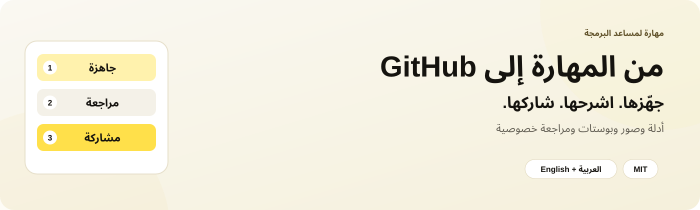
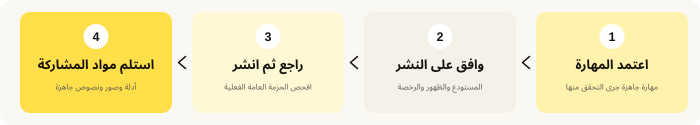
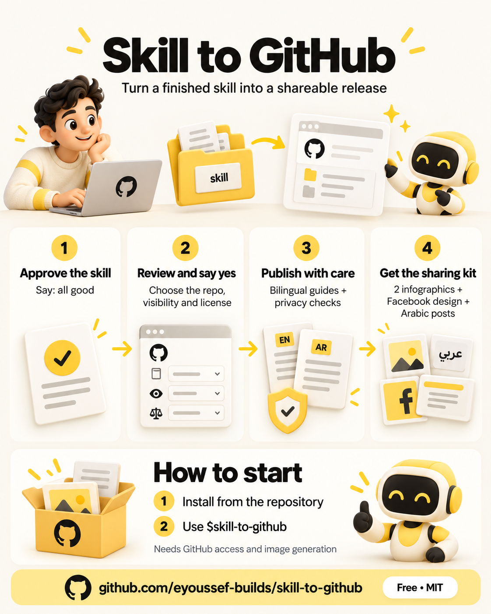

<div dir="rtl">

<p align="center"></p>

<p align="center"><a href="README.md"><b>Read this guide in English</b></a> · <a href="#installation">التثبيت</a> · <a href="#first-use">جرّبها</a> · <a href="#questions">أسئلة</a> · <a href="#share">المشاركة</a></p>

<p align="center">
  <a href="LICENSE"></a>
  <a href="docs/agent-installation.ar.md"></a>
  
</p>

---

## 👋 ما هي Skill to GitHub؟

أنشأت مهارة مفيدة لمساعد الذكاء الاصطناعي، وجرّبتها، وتريد أن يستخدمها غيرك. لكن مشاركة مجلد وحده ليست كافية: يحتاج الشخص شرحًا واضحًا، وخطوات تثبيت، وطريقة يبدأ بها.

**Skill to GitHub تساعد مساعدك في تحويل المهارة الجاهزة إلى مشروع عام يستطيع الناس فهمه واستخدامه ومشاركته.**

1. تنتهي من المهارة وتقول **«all good»** أو **«تمام»**.
2. يجهّز المساعد الحزمة و**يسألك هل تريد نشرها**.
3. تراجع اسم المستودع وظهوره والرخصة، ثم تقول **نعم** عندما توافق.
4. يكمل الإصدار المتفق عليه: **الأدلة ومراجعة الخصوصية والنشر ومواد المشاركة**.

<p align="center"></p>

هي لمن ينشئ مهارات للمساعدين ويريد مشاركتها دون تكرار نفس تعليمات النشر كل مرة. **المهارة** ببساطة مجلد تعليمات لمساعدك. وهذا المشروع نفسه مهارة، وليس تطبيقًا منفصلًا أو بوت GitHub.

### ماذا تستلم؟

| الجزء | النتيجة |
| --- | --- |
| 📦 حزمة نظيفة | المهارة ومواردها المطلوبة، منفصلة عن ملفات العمل الخاصة. |
| 📖 أدلة مفهومة | شرح عربي وإنجليزي، وتثبيت، وأمثلة بداية، وأسئلة شائعة. |
| 🔎 مراجعة خصوصية | مراجعة الملفات العامة وبيانات الصور وسجل Git قبل النشر، ثم قراءة النسخة المنشورة ومراجعتها. |
| 🐙 مشروع GitHub | المستودع أو التحديث المتفق عليه، برخصة مناسبة ووصف واضح. |
| 🖼️ صورتان إنفوجرافيك | واحدة بالإنجليزية وأخرى بالعربية، تشرحان المهارة وكيف تبدأ. |
| 🎨 تصميم فيسبوك | تصميم عربي إضافي بألوان البراند وصورة حقيقية للمستودع أو المنتج. |
| ✍️ نصوص سوشيال | بوستات عربية لـ X وThreads وفيسبوك ولينكدإن، ورد جاهز بالرابط. |

الألوان الافتراضية أصفر دافئ وكريمي وأسود حبر، ويمكنك طلب ألوانك. نصوص السوشيال بالعربية المصرية، مع توافق الروابط وكلمة التعليقات ووصف الرخصة.

---

<a id="installation"></a>

## 📥 التثبيت — خطوة بخطوة

**تحتاج إلى:** مساعد يستطيع قراءة الملفات. الإصدار الكامل يحتاج أيضًا صلاحية كتابة على GitHub، وأدوات ملفات وGit، وأداة توليد صور متاحة. برنامج المراجعة المحلي الاختياري يحتاج Python 3. تثبيت المهارة لا يضيف هذه الأدوات ولا يسجّل دخولك إلى الخدمات.

### أسهل طريقة: اطلب من مساعدك تثبيتها

1. **افتح مساعد البرمجة** في جلسة تستطيع التنزيل وحفظ الملفات.
2. **انسخ وأرسل:**

   ```text
   ثبّت skill-to-github من https://github.com/eyoussef-builds/skill-to-github.
   اقرأ دليل التثبيت وافحص المهارة وبرامجها أولًا. ثبّت مجلد
   skills/skill-to-github كاملًا في مكان المهارات الشخصية المدعوم للمساعد.
   حافظ على أي نسخة معدّلة، وقل لي كيف أبدأ.
   ```

3. **اقرأ طلبات إذن التنزيل أو حفظ الملفات.** يحتاج المساعد السماح بحفظ المجلد.
4. **تأكد أنها ظهرت:** «هل ترى skill-to-github؟ وضّح لي ماذا يحدث قبل نشر أي شيء».

🎉 **جاهزة؟ جرّب [أول إصدار](#first-use).**

### تفضّل نسخ المجلد بنفسك؟

1. **[حمّل ZIP](https://github.com/eyoussef-builds/skill-to-github/archive/refs/heads/main.zip).**
2. **فك الضغط.** على الماك انقر مرتين. على Windows اضغط بالزر الأيمن ثم **Extract All…**.
3. افتح المجلد الناتج ثم **skills** ثم **skill-to-github**.
4. انسخ **مجلد المهارة كاملًا** إلى المكان المحدد في [دليل مساعدك](docs/agent-installation.ar.md).
5. أعد فتح المساعد أو تحميل المهارات عند الحاجة، ثم اطلب استخدام **skill-to-github**.

يغطي الدليل **15 مساعدًا** مع خطوات macOS وLinux وWindows حسب الحاجة. دعم المهارات الأصلي يختلف عن تكييف التعليمات بالقراءة الصريحة، وعن توافر الأدوات. يوضح الدليل ذلك؛ مراجعة الوثائق لا تعني تجربة التنفيذ على كل مساعد.

---

<a id="first-use"></a>

## 🚀 أول إصدار لك

### 1. أنهِ المهارة التي تريد مشاركتها

أنشئ المهارة أو حدّثها، وجرّب ما يهم فيها، وأكمل الأجزاء الناقصة. بعدها قل **«all good»** أو **«تمام»** في سياق تلك المهارة.

إذا اختارها المساعد تلقائيًا، تعرض عليك مشاركة المهارة الجاهزة. قبول صورة عادية أو تعديل كود غير مرتبط لا يبدأ هذه الخطوات. ويمكنك استدعاؤها صراحة. في Codex قل:

```text
استخدم $skill-to-github للمهارة التي انتهينا منها.
جهّز الحزمة العامة النظيفة، والأدلة العربية والإنجليزية، والصورتين،
وتصميم فيسبوك ونصوص السوشيال بالعربي. اسألني عن النشر إذا لم أوافق عليه بعد.
```

في Claude Code استخدم `/skill-to-github`؛ ولغيره اتبع دليله أو اطلب المهارة بالاسم.

### 2. راجع قرار النشر

يحدد المساعد المهارة المطلوبة ويجهّز ملفات قابلة للمراجعة، ثم يقترح صاحب المستودع واسمه وظهوره والرخصة. **«تمام» وحدها لا تنشر شيئًا.**

قل **نعم** للاقتراح المحدد عندما توافق، أو **لا** لتبقى محلية. طلب النشر الصريح يعطي الإذن المناسب بالفعل؛ فلا تحتاج لتكرار الموافقة عند كل خطوة روتينية.

### 3. دعه يجهّز ويراجع الإصدار

يفصل الملفات القابلة للمشاركة عن تفضيلاتك وشغلك الخاص، ويكتب الأدلة باللغتين، ويولّد الصور، ويراجع الملفات العامة المحددة، ثم ينشر المتفق عليه بأدوات GitHub المسموح بها. بعدها يقرأ الملفات والسجل المتاح فعليًا من GitHub ويقارنها بالحزمة التي راجعها.

إذا نقصت صلاحية أو أداة أو قرار مهم، يوضح النقص المحدد. فحص الأنماط يساعد في المراجعة؛ لا يثبت إزالة كل معلومة خاصة محتملة.

### 4. انسخ مواد المشاركة

تستلم **ثلاث صور منفصلة**: إنفوجرافيك إنجليزي، وإنفوجرافيك عربي، وتصميم فيسبوك عربي. ومعها أربع خانات نصية قابلة للنسخ:

| الخانة | شكلها |
| --- | --- |
| SHORT — X / Threads | أقل من 280 حرفًا، وبداخلها رابط المستودع. |
| FACEBOOK | مصري ودود، من غير رابط، وينتهي بكلمة تطلبها في التعليقات. |
| LINKEDIN | من 150 إلى 250 كلمة، مهني ودافئ، من غير رابط، وبنفس الكلمة. |
| REPLY | سطر أو سطران للرد أو الرسالة، مع الرابط. |

يقرأ README والنسخة العربية إن وجدت والإصدار الأحدث والرخصة قبل كتابة النصوص. يمكنك تحديد كلمة التعليقات؛ وإلا يختار اسمًا عربيًا قصيرًا من 1 إلى 3 كلمات ويخبرك به. تظهر نفس الكلمة في التصميم والبوستين. تجهيز الرد لا يرسله ولا يفعّل أتمتة للتعليقات.

<details><summary><b>🔧 كيف يكمل إصدارًا انقطع في منتصفه؟</b></summary>

يمكن حفظ حالة الإصدار في ملف خاص خارج الحزمة العامة: الهدف الذي وافقت عليه، والملفات، والنسخة المراجعة، والصور والخطوة التالية. يحتوي المستودع قالبًا فارغًا فقط، وليس حالة عمل حقيقية. يساعد في الاستكمال دون تكرار المستودعات أو القرارات، ولا يشغّل العمل في الخلفية.

</details>

---

## 🔒 الخصوصية في دقيقة

- يحتوي المستودع تعليمات قابلة لإعادة الاستخدام وقوالب فارغة وأدلة وصورًا عامة واختبارات ببيانات **مصطنعة**.
- التوزيع يستبعد الملفات الشخصية والمحادثات الخاصة وتقارير العمل الحقيقية وتفاصيل الأجهزة والمفاتيح السرية.
- يقرأ البرنامج الاختياري ملفات التجهيز التي حددتها ويعرض نقاطًا للمراجعة؛ لا يرفع ملفات ولا ينشر مستودعات.
- نموذج مساعدك وخدمة الصور والأدوات المتصلة تعالج مدخلاتها وفق إعداداتها. فقط الحزمة التي وافقت عليها تُنشر على GitHub.

اقرأ [دليل الخصوصية](docs/privacy.ar.md) قبل مشاركة ملفاتك.

---

<a id="questions"></a>

## ❓ أسئلة وأجوبة

<details><summary><b>هل هي مجانية؟</b></summary>

المهارة مجانية ومفتوحة المصدر بترخيص MIT، بما فيه الاستخدام التجاري مع إبقاء إشعار الرخصة. يظل لاشتراك المساعد وAPI وتوليد الصور والخدمات الأخرى تكاليفها الخاصة.

</details>

<details><summary><b>هل ستنشر كلما قلت «تمام»؟</b></summary>

لا. يجب أن يكون السياق إنشاء مهارة جاهزة أو تعديلًا مهمًا لها. تعرض النشر وتنتظر موافقتك إن لم تعطها من قبل. ليست مراقبًا للنظام أو مهمة مجدولة. الاختيار التلقائي يعتمد على المساعد، ويمكنك استدعاؤها بالاسم.

</details>

<details><summary><b>هل تثبيتها يربط حساب GitHub؟</b></summary>

لا. استخدم أدوات GitHub الموثّقة في مساعدك أو CLI مسجّل الدخول وله صلاحية الكتابة المطلوبة. المهارة لا تحتوي بيانات دخول ولا تتجاوز صلاحياتك.

</details>

<details><summary><b>هل تنشر البوستات أو ترسل الرسائل؟</b></summary>

تجهّز النصوص والصور. النشر على المنصات وتفعيل إرسال تلقائي للتعليقات والردود والرسائل يحتاج طلبًا منفصلًا وأدوات مناسبة.

</details>

<details><summary><b>هل أستخدم ألواني ولغتي؟</b></summary>

نعم. وضّح البراند والجمهور في طلبك. الافتراضي أدلة عربية وإنجليزية ونصوص سوشيال مصرية وتصميم أصفر وكريمي وأسود. تفضيلاتك الصريحة الحالية لها الأولوية.

</details>

<details><summary><b>ماذا لو لم تتوفر أداة صور؟</b></summary>

يكمل المساعد الأعمال المستقلة ويذكر الصور المطلوبة التي تعذر توليدها. لا يصف مواد المشاركة بأنها مكتملة، ولا يشتري خدمة أخرى دون الإذن المناسب.

</details>

<details><summary><b>هل تحدّث مهارة منشورة بالفعل؟</b></summary>

نعم. يفحص المستودع والعمل الحالي ويحافظ على التعديلات غير المرتبطة ويتبع قواعد الفروع وطلبات الدمج. لا يحتاج إنشاء مستودع جديد لكل تعديل.

</details>

<details><summary><b>كيف أحدّثها أو أحذفها؟</b></summary>

قارن التنزيل الجديد بمجلدك المثبّت واحفظ تعديلاتك وملفك الشخصي الخاص. للحذف أزل مجلد `skill-to-github` المثبّت فقط أو استخدم أداة الإزالة في مساعدك. لا تتأثر المستودعات الموجودة. راجع [حل المشكلات](docs/agent-installation.ar.md#حل-المشكلات).

</details>

---

<a id="share"></a>

## 🖼️ شارك المهارة

[إنفوجرافيك إنجليزي](docs/images/infographic-en.png) · [إنفوجرافيك عربي](docs/images/infographic-ar.png) · [تصميم فيسبوك](docs/images/facebook-post-ar.png) · [نصوص السوشيال العربية](docs/social-posts.ar.md) · [نصوص مشاركة باللغتين](docs/share.md)

<p align="center">
  <a href="docs/images/infographic-en.png"></a>
  <a href="docs/images/infographic-ar.png"></a>
</p>

<p align="center"><a href="docs/images/facebook-post-ar.png"></a></p>

## 🛠️ للمطوّرين

```text
skills/skill-to-github/
  SKILL.md       طريقة الإصدار وحدود الموافقات
  references/    إرشادات الأدلة والصور والخصوصية ونصوص السوشيال
  assets/        قوالب فارغة لحالة الإصدار والنصوص
  scripts/       برنامج مراجعة اختياري للقراءة فقط واختبارات مصطنعة
  agents/        بيانات Codex
docs/            أدلة التثبيت والخصوصية باللغتين والصور العامة
```

يفحص البرنامج الاختياري **قائمة ملفات تختارها صراحة**، وأنماطًا شائعة للمفاتيح والمسارات، والبريد غير المعتمد، وبيانات PNG النصية وEXIF. يحسب بصمات الملفات دون تعديلها. لا يفهم معنى الصور ولا يضمن إخفاء الهوية ولا يفحص سجل Git أو ينشر مستودعًا. يراجع المساعد هذه الأجزاء بصورة منفصلة.

شغّل الاختبارات المصطنعة من جذر المستودع:

```sh
python3 -B -m unittest discover -s skills/skill-to-github/scripts -p 'test_*.py' -v
```

على Windows استخدم `py -3` إذا كان مشغّل Python لديك. تستخدم الاختبارات أمثلة مخترعة ومجلدات مؤقتة؛ لا تقرأ محادثاتك أو ملفات حسابك الحقيقية. راجع [إجراءات المراجعة](skills/skill-to-github/references/privacy-review.md) لاستخدام البرنامج، واحتفظ بقوائم المراجعة وحالة الإصدار بشكل خاص.

## 🤝 الدعم والتواصل

لديك سؤال أو فكرة؟ [افتح بلاغًا](https://github.com/eyoussef-builds/skill-to-github/issues) بالعربية أو الإنجليزية. للأمور الخاصة راسل **[hello@eyoussef.me](mailto:hello@eyoussef.me)**. استخدم أمثلة مخترعة عند الإبلاغ عن سلوك مراجعة الخصوصية.

**إعداد [eyoussef-builds](https://github.com/eyoussef-builds)** · [hello@eyoussef.me](mailto:hello@eyoussef.me) · [eyoussef.me](https://eyoussef.me) · [ترخيص MIT](LICENSE)

</div>
