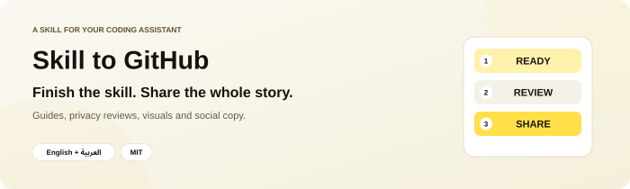
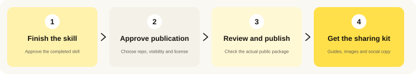

<p align="center"></p>

<p align="center"><a href="README.ar.md"><b>اقرأ هذا الدليل بالعربية</b></a> · <a href="#installation">Install</a> · <a href="#first-use">Try it</a> · <a href="#questions">Questions</a> · <a href="#share">Share</a></p>

<p align="center">
  <a href="LICENSE"></a>
  <a href="docs/agent-installation.md"></a>
  
</p>

---

## 👋 What is Skill to GitHub?

You made a useful skill for your AI assistant. It works, and now you want other people to use it. But sharing it means more than uploading a folder: people need an explanation, installation steps and a clear way to start.

**Skill to GitHub helps your assistant turn that finished skill into a public project people can understand and share.**

1. Finish a skill and say **“all good.”**
2. Your assistant prepares the package and **asks whether to publish it**.
3. Review the repository, visibility and license, then say **yes** when ready.
4. It completes the agreed release: **guides, privacy reviews, GitHub publication and sharing materials**.

<p align="center"></p>

This is for people who create reusable agent skills and want to share them without repeating the same release instructions. A **skill** is a folder of instructions for an AI assistant. This project is itself a skill, rather than a separate app or GitHub bot.

### What do you receive?

| Part | What it helps you deliver |
| --- | --- |
| 📦 Clean package | The reusable skill and needed resources, separated from private working files. |
| 📖 Friendly guides | English and Arabic READMEs, installation steps, examples and FAQs. |
| 🔎 Privacy review | Public files, image metadata and Git history reviewed before publication, then read back from GitHub for another review. |
| 🐙 GitHub project | The agreed repository or update, with a suitable license and clear description. |
| 🖼️ Two infographics | Separate English and Arabic images explaining the skill and how to start. |
| 🎨 Facebook design | An additional branded Arabic promo graphic with a real repo/product visual. |
| ✍️ Social copy | Arabic X/Threads, Facebook and LinkedIn posts, plus a reply with the link. |

The default artwork uses warm yellow, cream and ink. You can ask for your own brand. Social posts use Egyptian Arabic and keep links, comment keywords and license claims consistent.

---

<a id="installation"></a>

## 📥 Install it — step by step

**You need:** an assistant that can read files. A complete release also needs GitHub write access, file/Git tools and an available image-generation tool. The optional local review helper needs Python 3. Installing the skill does not supply these tools or sign you into services.

### Easiest: ask your assistant to install it

1. **Open your coding assistant** in a session that can download and save files.
2. **Copy and send:**

   ```text
   Install skill-to-github from https://github.com/eyoussef-builds/skill-to-github.
   Read its installation guide and inspect the skill and helper scripts first.
   Install the complete skills/skill-to-github folder in this agent's supported
   personal skill directory. Preserve any customized copy. Tell me how to start.
   ```

3. **Read any download/file permission request.** The assistant needs permission to save the folder.
4. **Check discovery:** “Can you see skill-to-github? Explain what happens before anything is published.”

🎉 **Ready? Try [your first release](#first-use).**

### Prefer copying the folder yourself?

1. **[Download the ZIP](https://github.com/eyoussef-builds/skill-to-github/archive/refs/heads/main.zip).**
2. **Unzip it.** On Mac, double-click. On Windows, right-click → **Extract All…**.
3. Open the extracted folder → **skills** → **skill-to-github**.
4. Copy that **whole skill folder** to the location in [your agent's guide](docs/agent-installation.md).
5. Reload/reopen the assistant if needed, then ask it to use **skill-to-github**.

The detailed guide covers **15 agents**, including macOS/Linux and Windows steps where applicable. Native skill support, instruction-reading adaptations and available tools differ. Documentation checks are not a claim of testing every agent.

---

<a id="first-use"></a>

## 🚀 Your first release

### 1. Finish the skill you want to share

Create or update a skill, try its important behavior, and resolve unfinished scaffolding. Then say **“all good”** or **“تمام”** in that context.

When the host selects this skill automatically, it offers to share that finished skill. Approval of an unrelated image or ordinary code change does not trigger this flow. Explicit invocation is available. In Codex:

```text
Use $skill-to-github for the skill we just finished.
Prepare its clean public package, English/Arabic guides, both infographics,
Facebook design and Arabic social posts. Ask whether to publish if I have
not already approved publication.
```

In Claude Code use `/skill-to-github`; for other agents, follow their guide or ask for the skill by name.

### 2. Review the publication decision

The assistant identifies the exact skill, prepares reviewable files and proposes the GitHub owner/repository, visibility and license. **“All good” does not publish anything by itself.**

Say **yes** to the concrete proposal, or **no** to keep it local. An explicit request to publish already provides the relevant authorization; routine release steps do not need repeated approval.

### 3. Let it prepare and check the release

It separates reusable files from private preferences and work, writes both guides, creates the visuals, reviews the exact public package and publishes the agreed content through your authorized GitHub tools. It then reads the actual files and reachable history back from GitHub and compares them with the reviewed package.

If account access, tools or a material decision is missing, it explains the specific gap. A pattern scan is a review aid, not proof that every possible private detail has been removed.

### 4. Copy the sharing materials

You receive **three separate artworks**: an English infographic, an Arabic infographic and an Arabic Facebook promo design. The social pack has four copyable blocks:

| Block | Format |
| --- | --- |
| SHORT — X / Threads | Under 280 characters; includes the repository link. |
| FACEBOOK | Friendly Egyptian Arabic; no URL; comment-keyword CTA. |
| LINKEDIN | 150–250 words; warm professional Arabic; no URL; same keyword. |
| REPLY | One or two lines with the repository link. |

It reads the actual README, Arabic README if present, latest release and license before writing. Supply a keyword if you want one; otherwise it chooses a memorable 1–3 word Arabic name and tells you. The design and both long posts use that same keyword. Preparing a reply does not send it or create comment automation.

<details><summary><b>🔧 How can an interrupted release resume?</b></summary>

The assistant can keep a private release-state file outside the public package: approved target, file manifest, reviewed commit, graphics and next action. The repository includes a blank template, not the creator's actual state. This helps resume without duplicate repositories or repeated decisions. It does not create background execution.

</details>

---

## 🔒 Privacy in one minute

- This repository contains reusable instructions, blank templates, documentation, public artwork and **synthetic** helper tests.
- Personal profiles, private chats, real work reports, device details and credentials are excluded from distribution.
- The optional helper reads chosen staging files and reports review candidates; it has no upload code and does not publish anything.
- Your model, image generator and connected services process their inputs under their own settings. Only the approved package goes to GitHub.

Read the [privacy guide](docs/privacy.md) before sharing your own files.

---

<a id="questions"></a>

## ❓ Questions & answers

<details><summary><b>Is it free?</b></summary>

The skill is free and open source under MIT, including commercial use with the license notice retained. Your assistant subscription, API/image generation and other services keep their own costs.

</details>

<details><summary><b>Will it publish every time I say “all good”?</b></summary>

No. The context must be a finished newly created or substantially revised skill. It offers sharing and waits for publication approval unless you already gave it. It is not a watcher or scheduled job. Automatic selection depends on the host; explicit invocation is available.

</details>

<details><summary><b>Does installation connect my GitHub account?</b></summary>

No. Use your host's normal authenticated GitHub tools or a signed-in CLI with write access. The skill does not contain credentials or bypass permissions.

</details>

<details><summary><b>Does it post to Facebook, LinkedIn or X?</b></summary>

It prepares copy and artwork. Posting, comment automation and sending replies or DMs require separate instructions and appropriate tools.

</details>

<details><summary><b>Can I use my own brand or language?</b></summary>

Yes. State your brand and audience. Defaults are English/Arabic guides, Egyptian Arabic social copy and yellow/cream/ink artwork. Current explicit preferences take precedence.

</details>

<details><summary><b>What if image generation is unavailable?</b></summary>

The assistant finishes independent work and reports which required images are missing. It should not claim a complete sharing kit or silently purchase another image service.

</details>

<details><summary><b>Can I update an existing public skill?</b></summary>

Yes. It checks the existing repository and local work, preserves unrelated changes and follows normal branch/PR rules. A new revision does not require a new repository.

</details>

<details><summary><b>How do I update or remove this skill?</b></summary>

Compare a fresh download with your installed folder and preserve customizations and any private local profile. To remove it, delete only the installed `skill-to-github` folder or use your agent's uninstall control. Existing GitHub repositories are unaffected. See [troubleshooting](docs/agent-installation.md#troubleshooting).

</details>

---

<a id="share"></a>

## 🖼️ Share this skill

[English infographic](docs/images/infographic-en.png) · [Arabic infographic](docs/images/infographic-ar.png) · [Facebook promo](docs/images/facebook-post-ar.png) · [Arabic social posts](docs/social-posts.ar.md) · [Bilingual captions](docs/share.md)

<p align="center">
  <a href="docs/images/infographic-en.png"></a>
  <a href="docs/images/infographic-ar.png"></a>
</p>

<p align="center"><a href="docs/images/facebook-post-ar.png"></a></p>

## 🛠️ For developers

```text
skills/skill-to-github/
  SKILL.md       Release workflow and approval boundaries
  references/    Documentation, artwork, privacy and social-copy recipes
  assets/        Blank release-state and caption templates
  scripts/       Optional read-only package reviewer + synthetic tests
  agents/        Codex metadata
docs/            Bilingual installation/privacy guides and public artwork
```

The optional reviewer checks an **explicit allowlist** of files, common secret/path patterns, unapproved emails and PNG text/EXIF metadata. It hashes reviewed bytes without changing the package. It does not inspect image meaning, guarantee anonymization, scan Git history or publish a repository. The assistant performs those separate reviews.

Run the synthetic tests from the repository root:

```sh
python3 -B -m unittest discover -s skills/skill-to-github/scripts -p 'test_*.py' -v
```

On Windows use `py -3` if that is your Python launcher. Tests use invented fixtures and temporary directories, not your real chats or home files. See the [review procedure](skills/skill-to-github/references/privacy-review.md) for helper usage. Keep manifests and release-state notes private.

## 🤝 Support & contact

Questions or ideas? [Open an issue](https://github.com/eyoussef-builds/skill-to-github/issues) in English or Arabic. For private matters, email **[hello@eyoussef.me](mailto:hello@eyoussef.me)**. Use invented examples when reporting privacy-review behavior.

**Created by [eyoussef-builds](https://github.com/eyoussef-builds)** · [hello@eyoussef.me](mailto:hello@eyoussef.me) · [eyoussef.me](https://eyoussef.me) · [MIT license](LICENSE)
